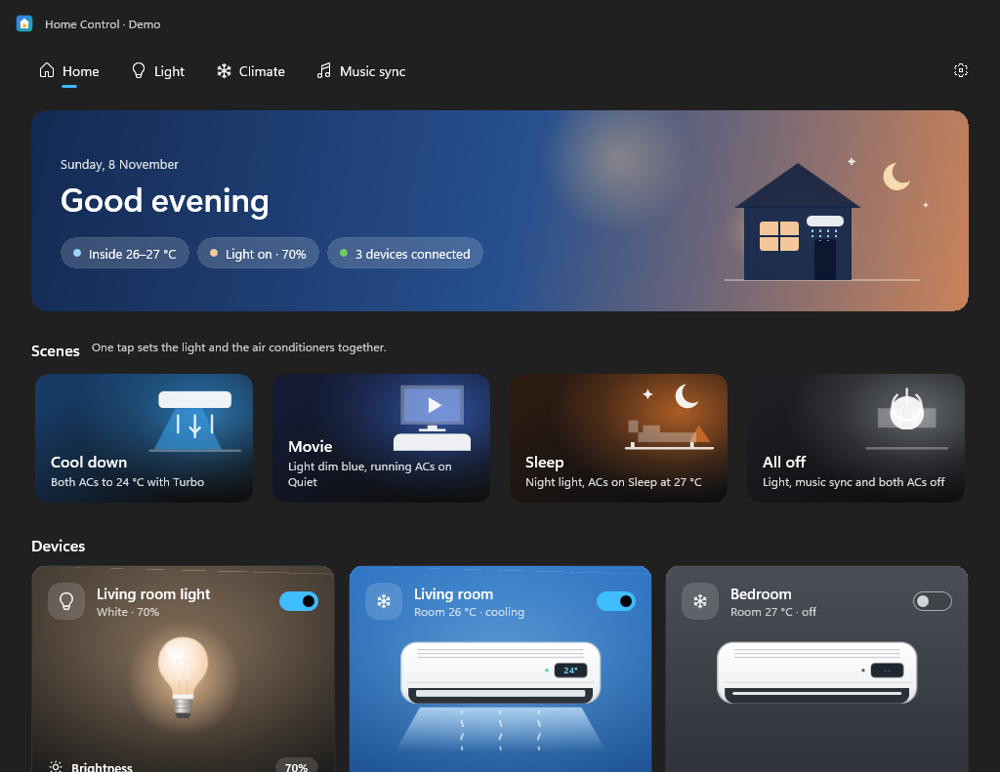
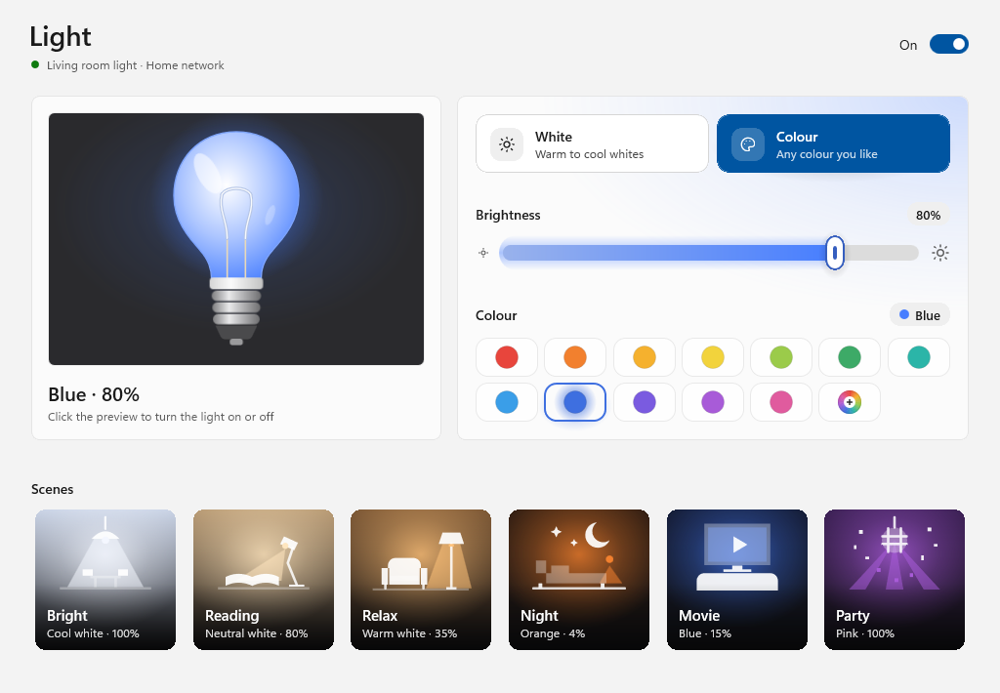
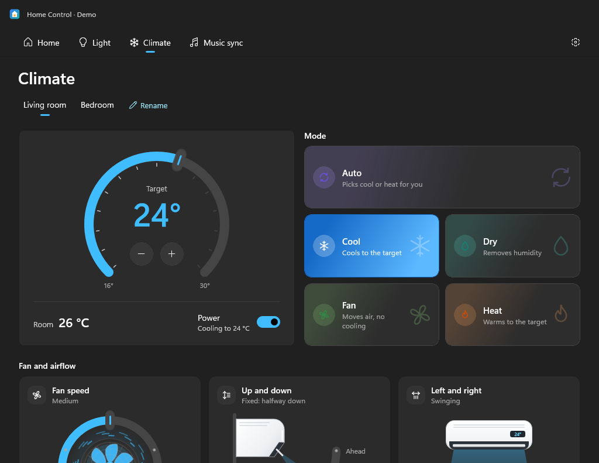
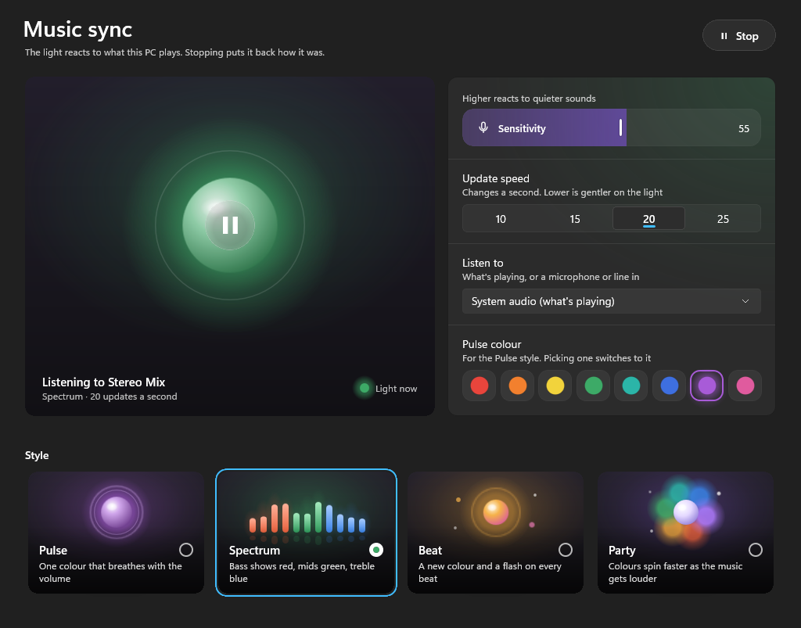
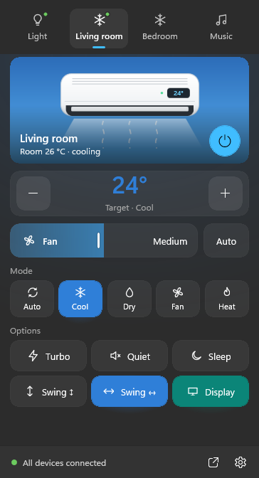

# Home Control

Control a Tuya (Smart Life) Wi-Fi light and Gree air conditioners from Windows, over your home network.

**Home Control 2.5** is a native Windows 11 app built with **WinUI 3 and the Windows App SDK** (C#, .NET 10), the
same UI framework Windows 11's own apps use. It talks to the devices directly: the light's encrypted local protocol
(Tuya 3.5), the Tuya Cloud API as a backup, the Gree air conditioner protocol and music analysis are all in C#.
Nothing else needs to be installed, and no server or account is needed for the air conditioners.



| Light | Climate |
| --- | --- |
|  |  |
| **Music sync** | **Quick panel** (from the notification area) |
|  |  |

The screenshots show the app's demo devices.

## Install

1. Download the latest `HomeControl-<version>-win-x64.zip` from [Releases](../../releases) and extract it.
2. Run **Install Home Control.cmd** in the extracted folder. It installs for your account only (no admin needed),
   adds a Start menu shortcut and an entry in Settings > Apps for uninstalling. Your settings are kept across updates.
   You can also just run `HomeControl.exe` from the folder without installing.
3. Open **Home Control** from the Start menu and follow [First-time setup](#first-time-setup).

The download isn't code-signed yet, so Windows SmartScreen may warn the first time: choose **More info** → **Run
anyway**. Needs Windows 10 (2004) or later, x64.

## Try it without devices

Run `HomeControl.exe --demo` to try it with a sample light and two air conditioners. They're simulated in memory:
nothing is sent over the network, your settings aren't read or changed, and changes last until you close it. It can
run beside the normal app.

## Using it

Pages are along the top: **Home**, **Light**, **Climate**, **Music sync**, and Settings (the gear on the right).

- **Home:** a banner with the time of day and a drawing of the house: its window glows with the light, and the
  AC blows air while any unit runs. It also shows the room temperatures and how many devices are connected.
  - **Scenes** set everything at once: **Cool down** (ACs to 24 °C with Turbo), **Movie** (light dim blue,
    running ACs on Quiet), **Sleep** (night light, ACs on Sleep at 27 °C) and **All off**.
  - **Device cards:** each one is a dark scene lit by its device. The light card has a bulb in the light's colour
    and two fill sliders: **Brightness** (amber) and **Warmth** (on a warm-to-cool track, which also tints the
    bulb, the card and the house window). Each air conditioner card shows the unit, with air flowing while it
    runs and a ring dial for the target temperature. The music sync card has a speaker and a play/stop button
    on a soft violet glow that breathes while sync runs. **Open ›** goes to the device's page.
- **Colour swatches** look the same everywhere: a soft rounded tile holding a round swatch; the picked one gets a
  ring and a glow in its own colour.
- **Fill sliders** (Home, Music sync and the quick panel): the whole rounded pill is the slider. Drag or click
  anywhere on it, or use the arrow keys.
- **Light:** the light's name and connection under the title, and the power switch on the right.
  - **Preview:** a realistic bulb that glows in the light's colour, brighter and wider the higher the brightness.
    Click it to turn the light on or off. It's as tall as the controls beside it.
  - **Controls**, in one card lit by the light's colour: **White** and **Colour** tiles, a thick brightness slider
    that fills in the light's colour, then either warmth (a warm-to-cool track) with five presets (Candle, Warm,
    Neutral, Daylight, Cool), or 12 colour swatches and a **Custom** rainbow swatch that opens a colour picker.
  - **Scenes:** illustrated cards (Bright, Reading, Relax, Night, Movie, Party), each a small room lit the way the
    scene lights it. The one the light currently matches is outlined.

  Changes made elsewhere, such as in the Smart Life phone app, show up straight away: the light reports them.
- **Music sync:** the light reacts to whatever the PC plays. **Start** (a violet button) / **Stop** is beside the title.
  - **Stage:** one glowing orb in the style's colour, breathing while sync runs, with play/stop in the middle,
    what it's listening to, and a dot showing the light's colour at that moment.
  - **Options:** sensitivity, update speed (10 to 25 a second), what to listen to (system audio or any input,
    such as Stereo Mix) and the Pulse colour (picking one switches to Pulse).
  - **Style**, as four illustrated cards:
    - **Pulse:** one colour breathing with the volume.
    - **Spectrum:** bass shows red, mids green, treble blue.
    - **Beat:** a new colour and a flash on every beat.
    - **Party:** colours spin with the energy.
  - It only works over the home network. **Stop** puts the light back how it was; changing the light on the
    Light page also stops it.
- **Climate:** one tab per air conditioner, with **Rename** beside the tabs.
  - **Temperature:** a big ring dial (16 to 30 °C) with the target and − / + in the middle; drag the ring or use
    the arrow keys. The room temperature and the power switch are underneath.
  - **Mode:** a card per mode (Auto, Cool, Dry, Fan, Heat), each with its own colours and a short description.
  - **Fan and airflow:** three panels, each a picture with its own arc slider:
    - **Fan speed:** a round fan inside a 270° ring (Low at the bottom left, round the top, to High). The rotor
      spins faster, and rings of air circle it, more and faster, at each step. It stands still while the unit is off.
    - **Up and down:** the unit seen from the side on its wall, with the louvre flap and the air beam, from
      straight ahead to straight down.
    - **Left and right:** the unit seen from the front, from far left to far right.

    Drag a handle or click a position. **Auto** lets the unit choose; **Swing** sweeps the whole range, and turning
    it off goes back to the last direction you picked. The text under each title says what's set ("Fixed: halfway
    down", "Swinging", "Automatic: the unit chooses").
  - **More options:** Windows Settings-style cards with a switch each: Turbo, Quiet, Sleep, Display light, Health
    (ionizer) and X-Fan. Point at or tap the ⓘ to see what an option does. Turbo and Quiet switch each other
    off, and Turbo only works in Cool and Heat.

  Changes show at once and are confirmed by reading the unit back; the page refreshes every 20 seconds, so
  changes from the remote show up too.
- **Settings:**
  - **Devices:** a row per device with its address and whether it's connected. Open the light's row for its
    ID, IP, protocol version and local key; open an air conditioner's row to rename or remove it.
    **Check connections** tests each way of reaching the light and fixes its IP address if it moved.
    **Find devices** looks for Gree air conditioners, pairs with new ones and updates addresses that changed.
  - **Connection:** Automatic, Home network only or Tuya Cloud only, and the Tuya Cloud account, with
    **Save and get local key**.
  - **App:** theme, "Keep running next to the clock" and "Start with Windows".
  - **About:** the version, and a button to open the settings folder.
- **Notification area icon:** click to open the **quick panel** just above the taskbar. It has a tab per device
  (the light, each air conditioner, music sync), each with a picture of the device lit by its state, its name
  and status, and a big power button. Below it, on a soft wash of the device's colour:
  - **Light:** brightness and warmth sliders, 8 colours and 6 scenes.
  - **Air conditioners:** the target temperature with big − and +, the fan slider with **Auto**, mode tiles in
    their own colours, and Turbo, Quiet, Sleep, Swing up/down, Swing left/right and Display.
  - **Music sync:** sensitivity, the four styles, update speed, the Pulse colour and what to listen to. The
    speaker glows while sync runs.

  The footer says whether every device is connected and has buttons to open the app or Settings. The panel
  closes when you click anywhere else. Right-click the icon for a menu: on/off, scenes, music sync, a menu per
  air conditioner (on/off, "Cool to 24 °C", More settings) and Quit.
- Only one copy runs at a time; opening it again brings the window forward.

Uninstall from **Settings > Apps > Installed apps > Home Control**. Your settings are kept.

## How it connects

- **Home network (fast, works without internet):** one encrypted connection kept open to the light
  (TCP 6668, Tuya protocol 3.5: AES-GCM with a per-session key). Commands take about 0.15 s.
  If the router gives the light a different IP, **Check connections** finds it and updates the setting.
- **Tuya Cloud (backup):** works from anywhere with internet, slower (about 0.5 to 1 s).

"Automatic" tries the home network first and falls back to the cloud, retrying the home network after a minute.

### Air conditioners

Gree units are controlled over the home network only (UDP port 7000, the protocol the Gree+ and EWPE Smart apps use
locally), so no account is needed. Each unit is paired once and gives back its own key, which is saved in the settings
file. Newer Wi-Fi modules use AES-GCM; older ones use AES-ECB, and the app handles both. Replies take about 0.1 s.
If a unit is paired again from the phone app it gets a new key; the app notices and pairs again. Many other AC brands
use Gree's Wi-Fi module and may work too.

### If a device can't be reached

Some Tuya and Gree Wi-Fi modules don't answer ARP lookups, so Windows can't find them even though the phone app
can. A permanent ARP entry fixes this (once, in an admin PowerShell; use your network adapter's name and the
device's IP and MAC address, which your router lists):

```
netsh interface ipv4 add neighbors "Ethernet" 192.168.1.50 aa-bb-cc-dd-ee-ff
```

To undo it: `netsh interface ipv4 delete neighbors "Ethernet" 192.168.1.50`. If the router later gives the device a
new address, the entry needs the new IP too, so it's best to reserve the device's address in the router (DHCP
reservation).

## Building

Needs Windows 10 or 11 (x64) and the .NET 10 SDK; Visual Studio isn't needed. `build.ps1` uses `dotnet` from
the PATH, or a per-user SDK in `%LOCALAPPDATA%\Microsoft\dotnet-sdk` if there is one.

```
cd native
.\build.ps1      # release build -> %LOCALAPPDATA%\Temp\HomeControlBuild\publish
.\install.ps1    # installs to %LOCALAPPDATA%\Programs\Home Control, Start menu, Settings > Apps
.\build.ps1 -Zip ..\out\HomeControl.zip   # also packs a release zip, as GitHub does
```

Build output goes to `%LOCALAPPDATA%\Temp\HomeControlBuild` because this folder's path is too long for
some build tools. For a design check without showing a window, run `HomeControl.exe --screenshots <folder>`;
it renders every page in light and dark themes off-screen. Add `--demo` to render the demo devices instead of
your own (that's how `docs/screenshots` is made). `--self-test <file.json>` checks the connection, tray, air
conditioners and audio capture, then exits.

`install.ps1` also replaces an "LED Control" install (the old name): it removes its folder, Start menu shortcut and
Settings > Apps entry, and moves its settings folder and "Start with Windows" entry to the new name. The app moves
the settings folder itself too, if it finds only the old one.

## Files

- `native/`: the app.
  - `Core/`: light protocol (`TuyaProtocol.cs`, `TuyaLink.cs`), cloud API (`TuyaCloud.cs`), routing between them
    (`LightController.cs`), state model, network discovery, and settings. Air conditioners: `Gree.cs` (encryption,
    scan, pairing, status and commands) and `AcState.cs`. `Demo.cs`: the simulated devices for `--demo`.
  - `Music/`: WASAPI audio capture (NAudio), FFT analysis and beat detection, and the streaming engine.
  - `Pages/`: the Light, Music sync, Air conditioners and Settings pages (XAML). `AirflowIcons.cs` holds the
    airflow arrows, drawn by a small script as filled shapes so they take the button's text colour.
  - `MainWindow`, `App`, `LightSession.cs` and `AcHub.cs` (shared UI state), and `Shell/` (tray icon, startup, uninstall).
  - Libraries: Windows App SDK 1.8, CommunityToolkit SettingsControls (Windows Settings-style cards),
    H.NotifyIcon (tray icon), NAudio.Wasapi (audio capture).
- `probe/`: a small console program that tests the protocol code against the light. `Probe.exe gree` finds and
  pairs the air conditioners, reads them and blinks the first one's display light (`--save` stores them in settings).
- Settings: `%APPDATA%\Home Control\config.json`. It holds your local key, cloud secret and the air conditioners'
  keys, so keep it private.
- The earlier Python versions (a PySide6 app and a browser panel) were removed after 2.4.1; they're in the git
  history up to commit `b5eabaf`.

## First-time setup

**The light.** Tuya lights need a *local key* for home network control. The Tuya Cloud project gets it for you:

1. Make a free account at iot.tuya.com and create a Cloud project (Smart Home). Pick the data centre your Smart Life
   account lives in; it isn't always the nearest one (accounts in Bangladesh, for example, are in Central Europe).
2. In that project, go to Devices → Link App Account, and scan the QR code with the Smart Life app (Me → scan icon).
   Then click OK in the "Link App Account" dialog on the website.
3. In Home Control, open Settings, enter the light's device ID (shown in the Tuya project's device list) and its IP
   address, and save.
4. Under Connection, enter the project's Access ID and Access Secret, and click **Save and get local key**.
5. Click **Check connections**.

**Air conditioners.** Click **Find devices** in Settings. Units on the same network are found and paired
automatically; rename them from their row.

## Tested with

- A Tuya "Smart Light RGBCW" bulb (protocol 3.5).
- Gree air conditioners with Wi-Fi module firmware V3.4.M (AES-GCM).

## Licence

[MIT](LICENSE). The Tuya local protocol code is ported from TinyTuya (also MIT); see
[THIRD-PARTY-NOTICES.md](THIRD-PARTY-NOTICES.md) for it and the libraries the app ships with.

## Contributing

Fixes, ideas and support for more devices are welcome: see [CONTRIBUTING.md](CONTRIBUTING.md). To ask for a device,
open an issue with the **Support my device** form.
